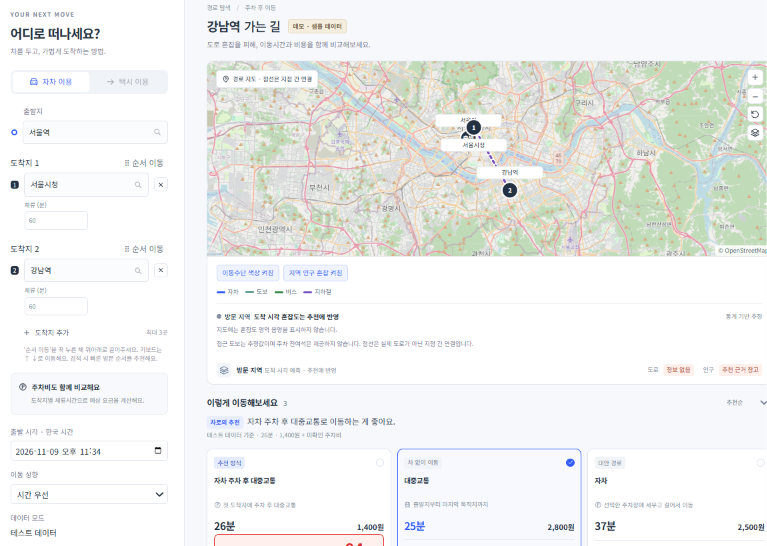
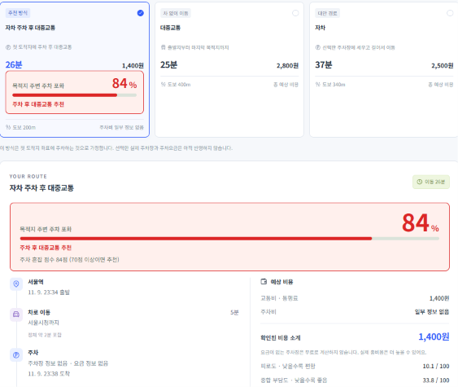

# 차로 (chalo) · 서울 경로 비교

출발지, 경유지(최대 3), 도착지를 입력하면 **자차 / 자차 주차 후 대중교통 / 대중교통** 경로를 비교하고, 어떤 방식이 왜 좋은지 근거와 함께 추천하는 서울 길찾기 웹 서비스입니다.

길찾기 엔진을 직접 만들지 않습니다. 카카오모빌리티, ODsay, 서울 열린데이터, 공공 주차 데이터를 조합해 **점수화하고 추천 근거를 설명하는 것**이 핵심입니다.





> 위 화면은 데모 모드(샘플 데이터)입니다. 주차 혼잡 84%는 샘플 값이고, 계산·추천 로직은 실제 서비스와 같습니다.

## 바로 실행해보기 (API 키 불필요)

데모 모드는 외부 API를 부르지 않고 샘플 데이터로 화면 전체(입력 → 주차장 선택 → 결과)를 보여줍니다. 순서 최적화, 점수 계산, 주차 혼잡 추천 로직은 실제 서비스와 같은 코드를 씁니다.

```bash
git clone https://github.com/movingmovingHoy/newSystem.git
cd newSystem
npm install        # Node.js 20.19 이상 (CI는 24)
npm run demo       # http://localhost:5173
```

- 기본 입력은 서울역 → 서울시청 → 강남역입니다. "더 나은 경로 찾기"를 누르고 주차장을 고르면 결과가 나옵니다.
- 강남역·홍대입구역 주변은 주차가 붐비는 것으로 설정해 두어서 **주차 후 대중교통 추천**을 볼 수 있습니다.
- 데모의 경로 시간·요금·노선·주차 상황은 모두 샘플이며 실제와 다릅니다. 화면 상단에 "데모 · 샘플 데이터"로 표시됩니다.
- PowerShell에서 npm이 막히면 `cmd /c "npm run demo"`.

## 주요 기능

**1. 세 가지 방식 비교**

- 자차: 선택한 주차장에 세우고 걸어서 다녀옵니다.
- 자차 주차 후 대중교통: 첫 도착지까지 차로 가서 주차하고, 다음 도착지는 대중교통으로 갑니다.
- 대중교통: 전 구간 대중교통.
- 경로 상세는 이동 순서대로 보여줍니다. (차 이동 → 주차 → 도보 → 체류 → 복귀 → 차 이동 → 도착)

**2. 경유지 순서 최적화와 시각 계산**

- 경유지 최대 3개, 순열 전체(최대 6가지)를 자차 소요시간으로 비교합니다. 순번 고정도 지원합니다.
- 출발 시각에서 이동시간과 체류시간을 더해 경유지별 도착·출발 시각과 최종 도착 시각을 계산합니다.

**3. 주차장 후보와 요금**

- 경유지 반경 1km에서 후보 3개(가까운 곳 / 저렴한 곳 / 균형)를 보여주고 하나를 고릅니다.
- 요금 정보가 없는 주차장도 후보에서 빼지 않고 "요금 정보 없음"으로 표시합니다. 주차비를 0원으로 계산하지 않고 "일부 정보 없음"으로 알려 줍니다.

**4. 설명 가능한 점수 (낮을수록 좋음)**

- 종합 부담도 = 시간 + 비용 + 피로도 + 혼잡 감점. 성향(시간 우선 / 비용 우선 / 체력 약함)에 따라 가중치가 달라집니다.
- 피로도 = 도보 거리, 환승 횟수, 운전 정체 시간. 정체 시간은 카카오 도로별 교통 상태로 계산합니다.
- 혼잡 감점은 서울 주요 121곳의 도착 시각 예측 혼잡도를 시나리오별 민감도(자차 1.0 > 주차 후 대중교통 0.5 > 대중교통 0.3)로 반영합니다.
- 점수만 보여주지 않고 "도착지 혼잡으로 자차 감점" 같은 근거 문장을 함께 만듭니다.

**5. 주차 혼잡 기반 추천 (주차 후 대중교통)**

- 최종 도착지 반경 1km의 실시간 주차장 포화율(현재 대수 합 ÷ 총 주차면 합)을 구합니다.
- 주차 혼잡 점수 = 포화율(0~100) + 혼잡도 가산(0~20). **70점 이상이면** "주차 후 대중교통" 추천 근거를 붙입니다.
- 정보가 없으면 0%로 치지 않습니다.
  - 최종 도착지 주변에 실시간 주차 정보가 없으면 이 경로를 만들지 않습니다.
  - 합계 주차면이 100면 미만이거나 30분 넘게 갱신되지 않은 값은 집계에서 뺍니다.
  - 출발이 지금보다 60분 넘게 뒤이면 정보 없음으로 봅니다.
- 점수가 낮아 추천 기준에 못 미치면 카드는 남기되 추천 1위는 될 수 없습니다. ("주차 여유"인데 추천 표시가 붙는 모순을 막기 위함)

## 구조

```
화면 (React)  ──  서비스(순서·주차·계산)  ──  planRoutes
                                              ├─ 순서 최적화 (optimizer)
                                              ├─ 시나리오 생성 (strategies)
                                              ├─ 점수·근거 (scoring)
                                              └─ 시각 누적 (timeline)
외부 API 호출은 providers/ 안에서만 → 캐시 래퍼(LRU, 동시 요청 합치기, 실패 시 만료 캐시) → Vite 프록시(키는 서버에서만 주입)
```

```
src/
  features/
    routing/      경로: providers, strategies, optimizer, scoring, timeline
    congestion/   혼잡도: 서울 주요 121곳 영역 매칭, 예측값 조회
    parking/      주차: 시설 정보 적재(SQLite), 반경 검색, 후보 선정, 실시간 포화율
  shared/         캐시, 공통 타입, 상수·가중치
  ui/             화면, 디자인 토큰, 서비스(화면용 조합)
```

- 주차장 시설 정보는 두 공공 데이터를 합쳐 SQLite에 저장하고 반경 검색은 DB에서 합니다. 수집에 약 5분이 걸려서, 날짜가 바뀌면 어제 데이터로 먼저 응답하고 뒤에서 갱신합니다(stale-while-revalidate).

## 실제 API로 실행하기

프로젝트 루트에 `.env`를 만들고(`.env.example` 참고) 키를 채운 뒤 `npm run dev` 합니다. 키는 서버(Vite 프록시)에서만 쓰이고 브라우저에는 노출되지 않습니다.

| 키                       | 용도                             | 발급                                            |
| ------------------------ | -------------------------------- | ----------------------------------------------- |
| `KAKAO_REST_API_KEY`     | 자차 길찾기, 장소 검색           | [카카오 개발자](https://developers.kakao.com)   |
| `ODSAY_KEY`              | 대중교통 길찾기                  | [ODsay](https://lab.odsay.com)                  |
| `SEOUL_CITYDATA_KEY`     | 서울 121곳 혼잡도                | [서울 열린데이터광장](https://data.seoul.go.kr) |
| `SEOUL_PARKING_KEY`      | 서울 공영주차장 시설·실시간 정보 | 서울 열린데이터광장                             |
| `TS_PARKING_SERVICE_KEY` | 교통안전공단 주차정보            | 공공데이터포털 (활용 신청 승인 필요)            |
| `VITE_KAKAO_JS_KEY`      | 현재 코드에서 쓰지 않음          |                                                 |

- 카카오 자차 길찾기는 별도 이용 신청이 필요할 수 있습니다. 무료 쿼터가 작아서 반복 조회하면 한도에 닿을 수 있습니다(특히 ODsay 일일 한도).
- 처음 주차장을 조회할 때 시설 DB가 비어 있으면 수집에 약 5분이 걸립니다. DB 파일(`data/*.sqlite`)은 저장소에 포함되지 않습니다.

## 개발

```bash
npm run dev         # 실제 API 모드 (.env 필요)
npm run demo        # 데모 모드 (키 불필요)
npm test            # 테스트 (단발)
npm run typecheck   # 타입 체크
npm run lint        # 린트
npm run build:demo  # 데모 빌드
```

- TypeScript `strict`, Vitest 테스트 52개 파일 357개, ESLint, Prettier, husky + lint-staged(커밋 전 검사), GitHub Actions(lint / typecheck / test).
- 핵심 로직(순서 최적화, 점수, 시각 누적, 캐시 키, 주차 후보 선정, 주차 혼잡 판단)은 테스트를 먼저 작성했습니다.

## 한계와 앞으로

- 실시간 주차 정보가 있는 곳이 적습니다. 서울 주요 121곳 주변 1km 기준 약 45%이고, 강남·홍대·성수는 없어서 이런 곳은 주차 후 대중교통 추천이 나오지 않습니다.
- 접근 도보는 직선거리 기반 추정입니다. (카카오 도보 API는 유료)
- 서서 가는 시간은 제공되는 데이터가 없어 피로도에 반영하지 못했습니다.
- 요청 사이에 경로 캐시를 공유하지 않아서 반복 조회가 외부 API 한도를 빨리 씁니다.
- 주차장 시설 DB 갱신은 지금 요청 시점에 일어납니다. 배포하면 하루 1회 배치로 옮깁니다.

## 문서

- [`AGENTS.md`](./AGENTS.md): 프로젝트 규칙과 설계 기준의 단일 원본 (시나리오 규칙, 점수, 주차 압박 기준 포함)
- [`AI_SPEC.md`](./AI_SPEC.md), [`HANDOFF.md`](./HANDOFF.md): 작업 분담과 인수인계 메모 (팀 내부용)
- 주차 데이터 적재 상세: [`src/features/parking/ingest/COMBINED.md`](./src/features/parking/ingest/COMBINED.md)
